# fractalviz

A terminal music visualizer that zooms endlessly into a fractal, in full color.

The zoom runs at a steady pace. Bass hits slow it down, highs speed it up, and it
always drifts back to steady once the music calms. On Julia and Phoenix the music
bends the shape itself, too. In the default **Glow** look,
the fractal's edges light up from black toward purple on bass and orange on highs.

## Fractals

The number is the `-f` option for jumping straight to it (keys `1`–`9` also
switch while it's running).

<table>
<tr>
<td align="center">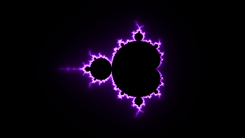<br><b>1</b> · Mandelbrot</td>
<td align="center">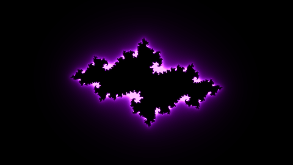<br><b>2</b> · Julia</td>
<td align="center">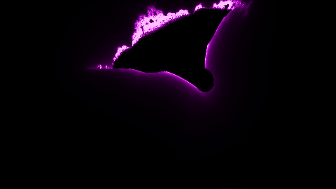<br><b>3</b> · Burning Ship</td>
</tr>
<tr>
<td align="center">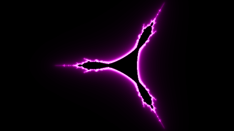<br><b>4</b> · Tricorn</td>
<td align="center">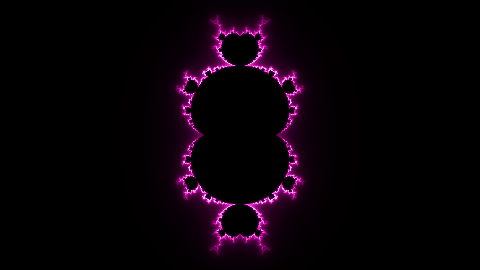<br><b>5</b> · Multibrot z³</td>
<td align="center">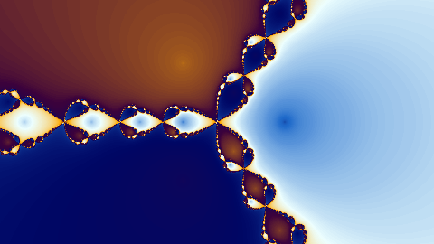<br><b>6</b> · Newton z³−1</td>
</tr>
<tr>
<td align="center">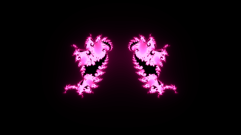<br><b>7</b> · Phoenix</td>
<td align="center">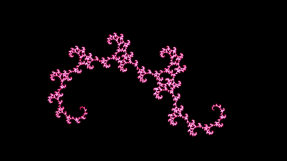<br><b>8</b> · Golden Dragon</td>
<td align="center">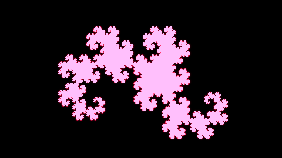<br><b>9</b> · Heighway Dragon</td>
</tr>
<tr>
<td align="center">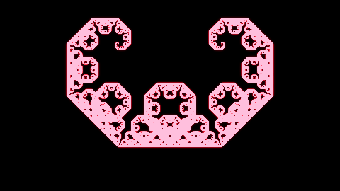<br><b>10</b> · Lévy C Curve</td>
<td align="center">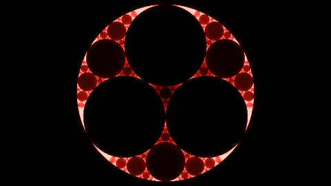<br><b>11</b> · Apollonian Gasket</td>
<td align="center">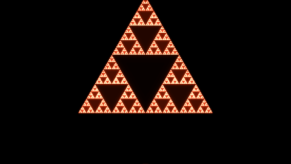<br><b>12</b> · Sierpinski Triangle</td>
</tr>
<tr>
<td align="center">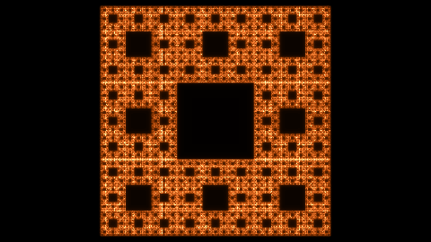<br><b>13</b> · Sierpinski Carpet</td>
<td align="center"><br><b>14</b> · Sierpinski Pentagon</td>
</tr>
</table>

## Run it

Needs Python 3, numpy, and `parec` (PulseAudio or PipeWire) to hear what your
speakers are playing. Use a terminal with truecolor support.

```sh
python3 fractalviz.py            # pick a fractal from the menu
python3 fractalviz.py -f 8       # go straight to the Golden Dragon
python3 fractalviz.py --mic      # listen to the microphone instead
python3 fractalviz.py --dj       # start in auto DJ mode
python3 fractalviz.py --detail 1 --fps 144
```

## Keys

| Key | Does |
| --- | --- |
| `1`–`9`, Tab, ←/→ | switch fractal |
| `p` / `P` (shift+p) | next / previous color palette |
| `a` | auto DJ: a big bass drop switches to a new fractal |
| `s` | save a 1280×720 screenshot to `~/Pictures/fractalviz` |
| `d` | detail 1x / 2x / 3x (smoother vs. faster) |
| `+` / `-` | base zoom speed |
| `[` / `]` | audio sensitivity |
| `h` | pin the info bar (it hides itself 5s after your last keypress) |
| `r` | restart the zoom |
| `q` / Esc | quit |
